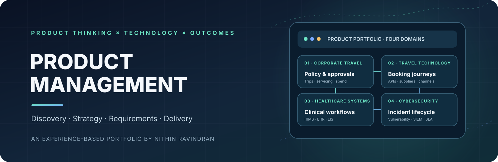
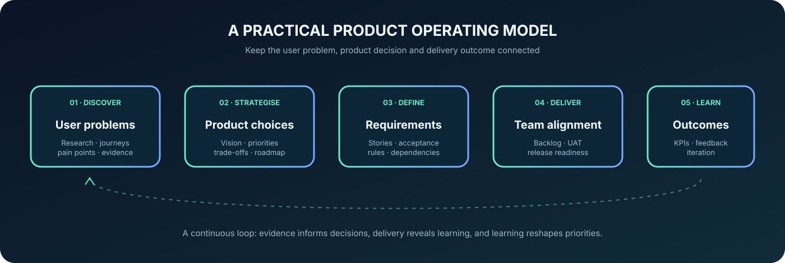

  
   

  
  
  
  

<h1 align="center">Turning complex problems into clearer product outcomes.</h1>

  An experience-based Product Management portfolio across travel technology, corporate travel, healthcare systems and cybersecurity operations.

  <a href="#-product-domains">Explore domains</a> ·
  <a href="#-featured-case-studies">Case studies</a> ·
  <a href="#-product-management-toolkit">PM toolkit</a> ·
  <a href="#-connect">Connect</a>

---

## ✦ Product management across four domains

I work across technology products where business workflows, user experience, system integrations and operational outcomes meet. My background combines business and systems analysis with product requirements, workflow definition, stakeholder alignment, delivery coordination, UAT and product-performance discussions.

This portfolio brings together professional product-domain context and practical artefacts that demonstrate how I approach product problems. The scope of ownership varies by engagement; this is not a claim of end-to-end ownership of every product function.

  

## ◈ Product domains

<table>
  <tr>
    <td width="50%">
      <h3>✈️ Corporate Travel Management</h3>
      
Employee travel requests, policy rules, approval hierarchies, itinerary servicing, supplier connectivity and spend visibility.

      
<strong>Product themes:</strong> policy clarity · approvals · booking lifecycle · trip operations

      <a href="10-case-studies/corporate-travel-platform.md">Read case study →</a>
    </td>
    <td width="50%">
      <h3>🌍 B2B &amp; B2C Travel Technology</h3>
      
Flights, hotels, transfers, activities, packages, booking journeys and multi-supplier integrations across partner and direct channels.

      
<strong>Product themes:</strong> travel commerce · conversion · supplier APIs · servicing

      <a href="10-case-studies/b2b-b2c-travel-tech-platform.md">Read case study →</a>
    </td>
  </tr>
  <tr>
    <td width="50%">
      <h3>🏥 Healthcare — HIMS, EHR &amp; Laboratory</h3>
      
Patient scheduling, clinical records, pharmacy, LIS, inventory and diagnostic-device interfaces across hospital workflows.

      
<strong>Product themes:</strong> workflow integrity · interoperability · UAT · release quality

      <a href="10-case-studies/healthcare-hims-ehr-laboratory-integration.md">Read case study →</a>
    </td>
    <td width="50%">
      <h3>🛡️ Vulnerability &amp; Incident Management</h3>
      
Scanner orchestration, vulnerability findings, SIEM correlation, incident lifecycle, remediation and SLA analytics.

      
<strong>Product themes:</strong> signal quality · incident states · remediation · MTTR

      <a href="10-case-studies/vulnerability-incident-management.md">Read case study →</a>
    </td>
  </tr>
</table>

## ✧ Selected project outcomes

The figures below are previously reported **project/team-level outcomes** associated with the relevant work. They are not independently audited results or individual-only attribution. Use only metrics approved for public disclosure.

| Product area | Reported project/team context |
|---|---|
| B2B & B2C Travel Technology | ~15% improvement in booking success; ~10–12% reduction in booking drop-offs |
| Healthcare Systems | 10+ hospital implementations; 15+ production releases; 92% first-pass UAT acceptance; 30% fewer post-deployment defects |
| Vulnerability & Incident Management | Scanner orchestration across 3,000+ infrastructure nodes; 35% lower MTTR; alert-to-actionable-incident conversion from 20% to 75% |
| Corporate Travel Management | Product workflows and KPI framework documented; no separate quantified result claimed in this portfolio |

A further reported delivery context in travel technology included 25–30% improvement in delivery efficiency and approximately 30% reduction in rework. Confirm baseline, measurement period and disclosure permission before using any figure in formal materials.

## ⌘ Featured case studies

Each case study covers the product context, users, representative workflows, reconstructed requirements, technical dependencies, delivery considerations, product measures and known limitations.

| Case study | What it explores |
|---|---|
| [Corporate Travel Management Platform](10-case-studies/corporate-travel-platform.md) | Policy-led travel requests, approvals, supplier booking and trip servicing |
| [B2B & B2C Travel Technology Platform](10-case-studies/b2b-b2c-travel-tech-platform.md) | Multi-product booking, channel needs, supplier connectivity and conversion |
| [Healthcare HIMS, EHR & Laboratory Integration](10-case-studies/healthcare-hims-ehr-laboratory-integration.md) | Hospital workflows, diagnostic-device integration and result traceability |
| [Vulnerability & Incident Management](10-case-studies/vulnerability-incident-management.md) | Scanner findings, SIEM correlation, incident state and remediation analytics |

[Browse the complete case-study library →](10-case-studies/README.md)

## ◉ Product Management toolkit

Reusable frameworks and reconstructed artefacts that show how I structure product work from discovery through delivery.

| CAPABILITY | WHAT IT COVERS | OPEN |
|---|---|---|
| **01 · Product strategy** | Vision, opportunity assessment, OKRs and outcome-based roadmaps | [Explore →](01-product-strategy/README.md) |
| **02 · Product discovery** | Problem framing, research plans, personas, interviews and journeys | [Explore →](02-product-discovery/README.md) |
| **03 · Product requirements** | PRDs, user stories, acceptance criteria and traceability | [Explore →](03-product-requirements/README.md) |
| **04 · Prioritisation** | RICE, MoSCoW, trade-offs and decision logs | [Explore →](04-prioritisation/README.md) |
| **05 · Product analytics** | KPI definitions, funnels, events and North Star metrics | [Explore →](05-product-analytics/README.md) |
| **06 · Product delivery** | Backlog refinement, sprint planning, UAT and release readiness | [Explore →](06-product-delivery/README.md) |
| **07 · Technical Product Management** | APIs, system context, integration risks and technical requirements | [Explore →](07-technical-product-management/README.md) |
| **08 · AI Product Management Learning Lab** | LLMs, RAG, AI agents, evaluation and responsible AI | [Explore →](08-ai-product-management/README.md) |
| **09 · Experimentation & Growth** | Experiment briefs, A/B analysis and growth frameworks | [Explore →](09-experimentation-growth/README.md) |
| **10 · Product case studies** | Domain-specific experience narratives and supporting examples | [Explore →](10-case-studies/README.md) |

## ◇ Product practices demonstrated

- **Discover:** clarify user needs, pain points, business context and product opportunities.
- **Frame:** define product problems, outcomes, scope, assumptions and constraints.
- **Specify:** translate requirements into workflows, user stories, acceptance criteria and traceability.
- **Prioritise:** weigh business value, user impact, feasibility, risk and dependencies.
- **Deliver:** align stakeholders, engineering and QA through backlog refinement, UAT and release readiness.
- **Measure:** define product and operational KPIs, interpret results and identify opportunities to iterate.

## ↗ Related portfolios

  
  
  

## ◌ Portfolio integrity & responsible disclosure

To keep the material credible and transparent:

- **Professional experience:** high-level product-domain context based on work experience, described without confidential details.
- **Reconstructed portfolio artefact:** sanitised examples rebuilt to demonstrate product reasoning; not original employer deliverables.
- **Reusable template:** a framework for adaptation; not evidence that the exact template was used in a company.
- **Illustrative / learning project:** a concept or learning exercise; not a claim of production launch.
- **Reported outcomes:** project/team-level figures as described above; retain only where disclosure is authorised and be ready to explain definitions and measurement context.

Do not publish employer-owned documents, source code, customer or patient data, credentials, internal architecture or commercially sensitive information. Technical and integration details should be reviewed against disclosure permissions before publication.

## Connect

  
  

Maintained by <strong>Nithin Ravindran</strong> · Product Management Portfolio

